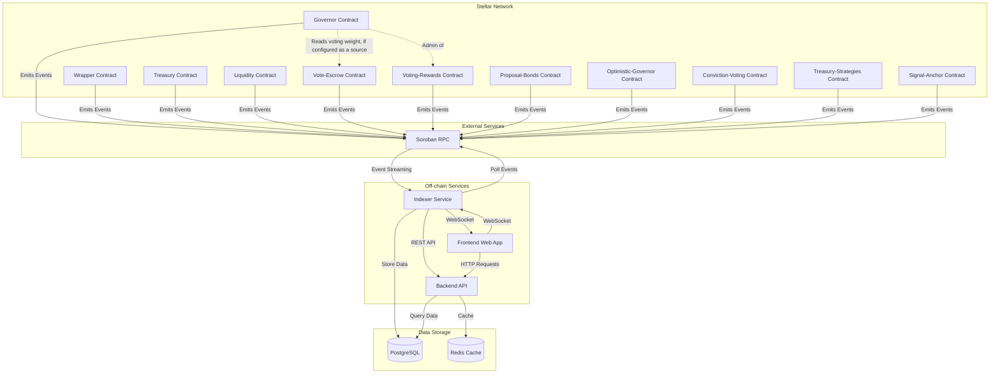
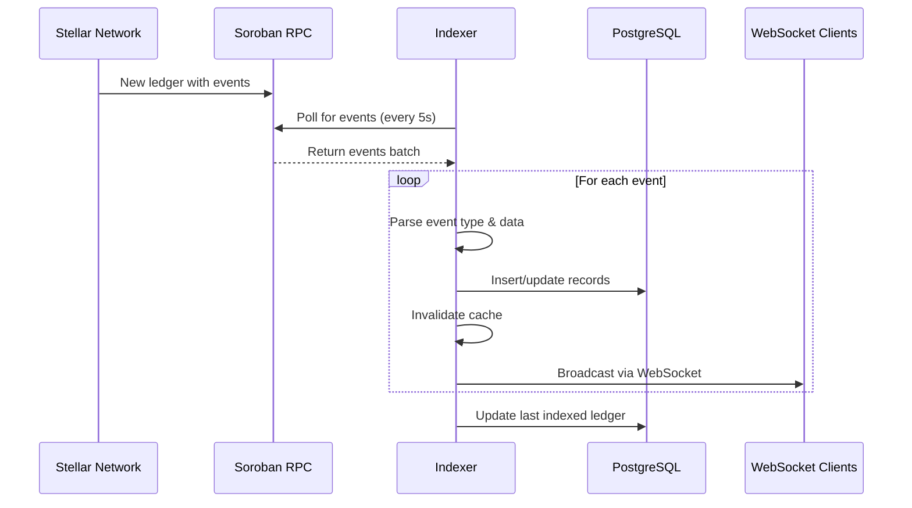
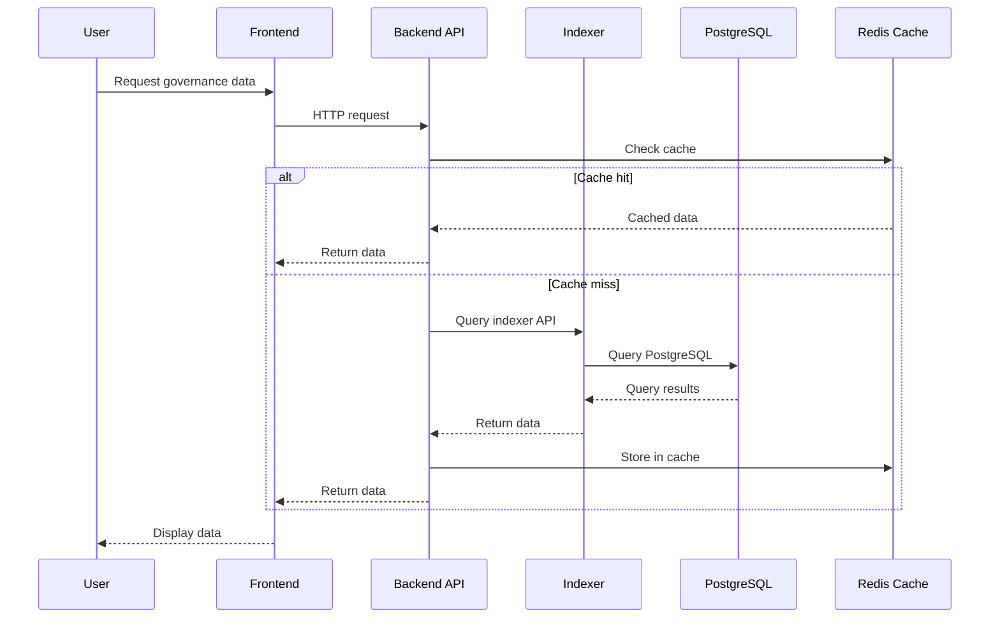
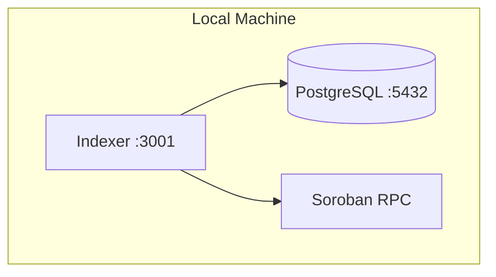
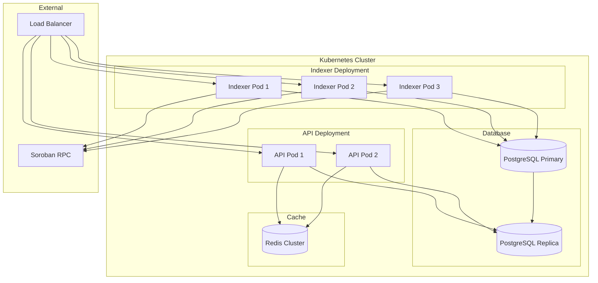

# NebGov System Architecture

This document describes the high-level architecture of the NebGov governance system, including all components and their interactions.

## System Overview

NebGov is a decentralized governance platform built on Stellar that enables on-chain proposal creation, voting, and execution. The system consists of smart contracts deployed on the Stellar network and off-chain services that index and analyze governance data.

## Architecture Diagram

## Components

### Stellar Smart Contracts

#### Governor Contract
The core governance contract that manages:
- Proposal creation and validation
- Voting mechanism (for, against, abstain)
- Proposal execution
- Configuration management
- Delegation system

**Key Events:**

- `ProposalCreated`: New proposal submitted
- `VoteCast` / `VoteCastWithReason`: Vote recorded
- `ProposalQueued`: Proposal queued for execution
- `ProposalExecuted`: Proposal executed successfully
- `ProposalCancelled`: Proposal cancelled
- `DelegateChanged`: Voting delegation updated
- `ConfigUpdated`: Governance parameters changed
- `GovernorUpgraded`: Contract upgraded
- `ReputationUpdated`: A proposer's reputation score changed
- `EffectiveThresholdChanged`: A proposer's reputation-adjusted proposal threshold changed

#### Proposer reputation

The governor keeps a `ProposerReputation` record per proposer address, read with `get_proposer_reputation`. The record adjusts the proposal threshold: `propose()` compares the proposer's voting power against `get_effective_threshold(proposer)`, which is the flat `proposal_threshold` multiplied by the proposer's `threshold_multiplier_bps`. Proposers with no history use 1x.

The score moves at these call sites:

1. **`propose()`** calls `record_proposal_created`, which increments `total_proposals`. It does not change the score.
2. **`queue()`** records `Succeeded` for a proposal that passed. This is the only outcome that carries participation, measured as total votes divided by quorum-eligible supply at the proposal's start ledger.
3. **`execute()`** records `Executed`.
4. **`cancel()`**, **`cancel_by_governance()`**, and **`cancel_queued()`** record `Cancelled`.
5. **`state()`** records `Defeated` when voting closes without quorum or a majority, and `Expired` when a succeeded proposal is not executed within the grace period. Each is guarded so it is recorded at most once.

Each outcome adds a fixed delta. A passed proposal whose participation is at or above 5,000 bps also gets a bonus. The score is clamped to `[-1000, 1000]`, then mapped linearly to a multiplier between 5,000 bps (0.5x) and 20,000 bps (2x). Until a proposer has `min_proposals_for_discount` (3) proposals, the multiplier cannot drop below 1x, so a new address can be penalized but not discounted. The default values are listed in [parameter-guide.md](./parameter-guide.md#proposer-reputation).

`apply_reputation_decay(proposer)` is permissionless. It moves a nonzero score back toward zero by `decay_rate_per_1000_ledgers` per 1,000 ledgers since the record was last updated. Each change emits `ReputationUpdated`, and `EffectiveThresholdChanged` when the threshold moves. The indexer mirrors these events into the `/reputation/*` endpoints. The scoring constants are compile-time values from `default_config()`, not governance-tunable, and there is no runtime switch to disable the system.

#### Timelock Contract
Holds queued governor actions until a mandatory delay has passed:
- Schedules single operations, atomic batches and DAG-ordered operations
- Enforces a minimum delay and an execution window
- Lets the governor or admin cancel pending operations

See [Timelock](./timelock.md) for the entrypoints, events, errors and deployment order.

#### Governor Factory Contract
Permissionless deployer for complete governance stacks (`contracts/governor-factory/`):
- `deploy` creates and initializes a Token-Votes, Timelock and Governor trio for a token in one call
- Validates the governor settings before anything is deployed
- Keeps a registry of every governor it deploys, readable with `get_governor` and `get_all_governors`

See [Governor Factory](./governor-factory.md) for the entrypoints, deploy parameters, events, errors and deployment order.

**Depends on:** the compiled Governor, Timelock and Token-Votes WASM, uploaded before the factory is initialized.

**Key Events:**
- `GovernorDeployed`: A new governor stack was deployed and registered

#### Wrapper Contract
Token wrapper that enables governance participation (see [token-votes-wrapper.md](./token-votes-wrapper.md)):
- Token deposits and withdrawals
- Delegation via wrapper
- Voting power calculation

**Key Events:**
- `Deposit`: Tokens deposited
- `Withdraw`: Tokens withdrawn
- `DelegateChanged`: Delegation updated

#### Treasury Contract
Manages treasury funds and batch transfers:
- Multi-recipient transfers
- Token management
- Approval workflows

**Key Events:**
- `BatchTransfer`: Batch transfer executed

#### Liquidity Contract
Provides liquidity pool functionality (see [liquidity.md](./liquidity.md)):
- Liquidity provision
- Token swapping
- Fee management

**Key Events:**
- `LiquidityAdded`: Liquidity provided
- `LiquidityRemoved`: Liquidity removed
- `Swap`: Token swap executed
- `PoolFeeUpdated`: Fee updated

#### Vote-Escrow Contract
A second source of voting weight alongside `token-votes` (`contracts/vote-escrow/`). Users lock the underlying
token for a chosen number of ledgers and receive voting power boosted by lock length.

- `create_lock`, `increase_lock_amount`, `extend_lock`, `withdraw` manage a single lock per owner
- Power starts at `amount` plus a boost of up to `max_multiplier_bps` (scaled by lock duration between
  `min_lock_duration` and `max_lock_duration`) and decays linearly back to `amount` as `end_ledger` approaches
- `get_votes`, `get_past_votes` and `get_past_total_supply` expose current and snapshot power, so a lock's power at
  a proposal's snapshot ledger can be recomputed later; `get_lock` and `get_lock_history` expose lock records
- `update_escrow_config` (admin) changes the duration bounds and the multiplier

**Depends on:** only the locked token (a SEP-41 token contract). It does not call the governor or `token-votes`.

**Read by:** any contract or client that calls its `get_past_votes` / `get_past_total_supply`. The governor does
this when the contract is configured as a voting-weight source (see
[Voting-weight sources](#voting-weight-sources)); the SDK's `VoteEscrowClient`, the CLI's `vote-escrow` command and
the frontend lock views read it directly.

**Key Events:**
- `LockCreated`: New lock created
- `LockIncreased`: Lock amount increased
- `LockExtended`: Lock end ledger extended
- `LockWithdrawn`: Locked tokens withdrawn

#### Voting-Rewards Contract
Pays voters for participating (`contracts/voting-rewards/`). A funded token pool is split per epoch across the
addresses that voted, in proportion to the voting power they cast.

Eligibility is computed off-chain and only a Merkle root goes on-chain, so the governor is untouched and no
unbounded per-epoch voter list is stored:

1. The backend job (`backend/src/jobs/voting-rewards-epoch.ts`) reads the indexer's `votes` table for an ended epoch,
   builds `(address, amount)` leaves and a Merkle tree.
2. The root is published with `publish_epoch_root`, which is admin-only. The admin is intended to be the governor's
   own address, so publishing a root is a governance-executed action rather than a trusted operator key.
3. Each voter calls `claim` with a Merkle proof for their leaf; a claim marker prevents double claims.

- `initialize(admin, reward_token, epoch_duration_ledgers)` opens epoch 0; `start_next_epoch` is permissionless once
  the current epoch has ended
- `fund_pool` adds reward tokens; `get_available_pool` is the balance not yet allocated to a published epoch
- `sweep_epoch` (admin) returns an epoch's unclaimed rewards to the available pool
- `propose_admin` / `accept_admin` (two-step admin rotation) and `update_epoch_duration` (admin) change authority and the duration of future epochs

**Depends on:** only the reward token (a SEP-41 token contract). Its admin should be set to the governor, so it must
be deployed and initialized after the governor (`scripts/deploy-testnet.sh` does this).

**Read by:** the backend epoch job, the SDK's `VotingRewardsClient`, the CLI's `voting-rewards` command and the
frontend `/rewards` route.

**Key Events:**
- `EpochStarted`: New epoch opened
- `EpochRootPublished`: Merkle root published and rewards allocated
- `RewardClaimed`: Voter claimed a reward
- `PoolFunded`: Tokens added to the pool
- `EpochSwept`: Unclaimed rewards returned to the pool

#### Co-Sponsorship Contract
Pools community voting power to meet the proposal threshold (`contracts/co-sponsorship/`). See [Co-Sponsorship](./co-sponsorship.md) for full entrypoints, events, errors, and deployment details.

Allows token holders who do not independently meet the proposal threshold to draft a proposal and collect pledges from other token holders:
- `create_draft` creates a pre-proposal draft with actions and calldata (bounded by `MAX_CALLDATA_SIZE` and `MAX_CALLDATA_COUNT`)
- `co_sponsor` and `withdraw_co_sponsorship` let addresses pledge and withdraw voting power toward a draft
- `finalize_draft` re-verifies live co-sponsor power against the governor's reputation-adjusted `get_effective_threshold` and promotes the draft via `propose_via_registry`
- `cancel_draft` allows the creator or admin to cancel an open draft; `get_draft` and `get_active_drafts` provide read and paginated access

**Depends on:** `token-votes` (for reading live voting power via `get_votes`) and `governor` (which exposes `get_effective_threshold` and `propose_via_registry`).

**Read by:** the SDK's `CoSponsorshipClient`, frontends for pre-proposal browsing and co-sponsorship flows, and the indexer.

**Key Events:**
- `DraftCreated`: Pre-proposal draft created
- `CoSponsored`: Voting power pledged to a draft
- `CoSponsorshipWithdrawn`: Pledged power withdrawn
- `DraftFinalized`: Draft reached threshold and promoted to governor proposal
- `DraftCancelled`: Draft cancelled by creator or admin
- `DraftExpired`: Expired draft observed

#### Proposal-Bonds Contract
Refundable proposer bonds (`contracts/proposal-bonds/`). A proposer locks a bond before creating a governor proposal.
The bond is refunded once the proposal resolves, or slashed by governance. See [Proposal Bonds](./proposal-bonds.md)
for the full lifecycle.

- `lock_bond` takes the bond from the proposer, keyed by the proposal's `description_hash`
- `refund_bond` returns the bond after the governor proposal resolves; `slash` sends it to a recipient instead
- `update_bond_amount` (admin) changes the required bond; `update_settings` (admin) changes the bond token, governor
  and refund windows; `set_admin` (admin) hands over the admin role; `get_bond` and `get_settings` read the state

**Depends on:** a SEP-41 bond token, and the governor, whose proposal state decides whether a bond is refunded.

**Key Events:**
- `BondLocked`: Bond taken from a proposer
- `BondRefunded`: Bond returned to a proposer
- `BondSlashed`: Bond confiscated
- `BondAmountUpdated`: Required bond amount changed
- `SettingsUpdated`: Bond token, governor or refund windows changed
- `AdminUpdated`: Admin role handed over

#### Optimistic-Governor Contract
The optimistic proposal track (`contracts/optimistic-governor/`). A proposal passes unless enough objections are
cast during its challenge window. See [Optimistic Governance](./optimistic-governance.md) for the full lifecycle.

- `propose` opens a proposal with a challenge window and takes a proposer bond
- `object` records an objection; an objected proposal is blocked
- `finalize` settles a proposal that was not blocked, and `execute` calls its target contract
- `cancel` lets the proposer withdraw before the proposal passes. It refunds the bond only if the proposal was not
  objected; an objected proposal's bond stays locked
- `release_bond` / `slash_bond` (admin, meant to be governance) return an objected proposal's bond to its proposer or
  send it to a recipient; `update_config` (admin) changes the parameters

**Depends on:** a SEP-41 bond token, the votes token used to read objector weight, and the target contract of each
proposal it executes.

**Key Events:**
- `ProposalCreated`: Proposal opened for its challenge window
- `ObjectionCast`: Objection recorded
- `ProposalObjected`: Proposal blocked by objections
- `ProposalPassed`: Challenge window ended without a blocking objection
- `ProposalExecuted`: Proposal executed on its target
- `ProposalCancelled`: Proposal withdrawn by its proposer
- `BondReleased` / `BondSlashed`: An objected proposal's bond returned to its proposer or slashed
- `ConfigUpdated`: Parameters changed

#### Conviction-Voting Contract
A self-executing alternative track (`contracts/conviction-voting/`). Supporters stake tokens on a proposal, its
conviction grows over time, and it executes once conviction reaches a threshold that scales with the requested
amount. See [Conviction Voting](./conviction-voting.md) for the conviction formula.

- `create_proposal` opens a proposal with a target call; `stake` and `withdraw_stake` manage a staker's position
- `checkpoint_conviction` advances a proposal's conviction and executes it once it meets `get_required_threshold`
- `cancel_proposal` lets the proposer or admin cancel an unexecuted proposal; `get_stakes` pages through stakes

**Depends on:** a SEP-41 votes token for staking, and the target contract of each proposal it executes.

**Key Events:**
- `ProposalCreated`: Proposal opened for staking
- `StakeUpdated`: A staker's position changed
- `ConvictionUpdated`: Conviction recomputed at a checkpoint
- `ProposalExecuted`: Conviction threshold met and the call executed
- `ProposalCancelled`: Proposal cancelled

#### Treasury-Strategies Contract
Governance-controlled yield allocation (`contracts/treasury-strategies/`). Idle funds held by the treasury can earn yield
through whitelisted external protocols. The contract never custodies funds on its own authority, and every withdrawal
settles back to the treasury. See [Treasury Yield Strategies](./treasury-strategies.md) for the adapter model.

- `register_strategy` whitelists an adapter for a token with an allocation cap and a withdrawal cooldown; `deactivate_strategy` (admin) turns one off
- `deposit` moves treasury funds into the strategy with the least allocation
- `request_withdrawal` starts the cooldown, and `claim_withdrawal` settles the funds back to the treasury
- `get_strategy`, `get_allocation`, `get_total_value` expose the state

**Depends on:** the treasury contract, which moves tokens in, and the adapter contracts, which hold the funds.

**Key Events:**
- `StratReg`: Adapter whitelisted
- `StratDeact`: Strategy turned off
- `Deposited`: Treasury funds allocated to a strategy
- `WdrawReq`: Withdrawal cooldown started
- `WdrawClaim`: Funds returned to the treasury

#### Signal-Anchor Contract
Anchors the results of off-chain signaling polls (`contracts/signal-anchor/`). Polls run off-chain with no gas cost, and
only the finalized result hash is written on-chain. See [Signal Anchor](./signal-anchor.md) for the poll flow.

- `anchor_result` stores a poll's `result_hash`. Only the admin (the backend's signaling service account) may call it,
  and only once per `poll_id`, so a published result cannot be changed
- `get_anchor` returns the anchored record for a poll; `admin` returns the configured anchorer

**Depends on:** nothing on-chain. The result hash is computed off-chain.

**Key Events:**
- `ResultAnchored`: A poll's result hash was anchored

#### Treasury-Streams Contract
Recurring payments from the treasury (`contracts/treasury-streams/`). The governor creates a stream once, and then any
caller can trigger each whole interval as it comes due. See [Treasury Streams](./treasury-streams.md) for the schedule
rules and errors.

- `create_stream` is governor-only. It sets up the stream and moves no funds
- `execute_stream` is permissionless and pays every whole interval that has come due
- `pause_stream`, `resume_stream` and `cancel_stream` are callable by the treasury (the admin) or the stream's creator
- a stream that has paid its last whole interval is marked `completed` and removed from `get_active_streams`

**Depends on:** a SEP-41 asset that the treasury transfers into the contract. The contract pays from its own balance.

**Read by:** the backend treasury-streams executor, the SDK's `TreasuryStreamsClient`.

**Key Events:**
- `StrmCreated`: Stream created
- `StrmExec`: Whole intervals paid
- `StrmPaused` / `StrmResumed`: Stream paused or resumed
- `StrmCancel`: Stream cancelled
- `StrmCompleted`: Last whole interval paid; stream removed from the active list

### Voting-weight sources

The governor reads voting weight through a three-method interface on the contract it is pointed at:
`get_votes`, `get_past_votes` and `get_past_total_supply` (plus `token`). It has no vote-escrow-specific code.
`token-votes` and `vote-escrow` both implement that interface, which is what makes vote-escrow usable as a source.
The governor's `VotingStrategy` decides how sources are combined:

| Strategy | Behavior |
|---|---|
| `Single` (default) | Weight and quorum supply come from the one `votes_token` address set at `initialize`. Point it at `token-votes` for token-balance voting. |
| `MultiToken(Vec<WeightedToken>)` | Weight is the sum over up to 5 sources of `get_past_votes(source) * weight_bps / 10000`, and quorum supply is summed the same way. List `token-votes` and `vote-escrow` together to compose them. |

So the two sources can either **compose** (`MultiToken` with both listed and a weight for each) or **replace** each
other (a `Single` strategy pointing at one of them). Voting weight is always read at the proposal's snapshot ledger,
which is why vote-escrow keeps lock history and global checkpoints. Changing the strategy is done with
`set_voting_strategy`, which requires the governor's own authorization, so it goes through a governance proposal.
Under `MultiToken`, a source that errors is counted as zero rather than failing the vote.

### Indexer Service

The indexer service (`packages/indexer/`) is responsible for:
- **Event Streaming**: Continuously polls the Stellar Soroban RPC for new governance events
- **Data Storage**: Processes and stores events in PostgreSQL
- **Real-time Notifications**: Broadcasts events via WebSocket to connected clients
- **API Endpoints**: Provides REST API for querying governance data

**Key Components:**
- **Event Processor** (`src/events.ts`): Fetches and processes events from Stellar RPC
- **REST API Server** (`src/api.ts`): Express server with HTTP endpoints
- **WebSocket Server** (`src/ws.ts`): Real-time event broadcasting
- **Cache Layer** (`src/cache.ts`): In-memory caching for performance
- **Database Layer** (`src/db.ts`): PostgreSQL connection and migrations

**Configuration:**
- Polls Stellar RPC every 5 seconds (configurable via `POLL_INTERVAL_MS`)
- Tracks last indexed ledger for resumption
- Supports multiple contract addresses (governor, wrapper, treasury, liquidity)

**API Endpoints:**
- `GET /health`: Health check and indexing progress
- `GET /stats`: Aggregate governance statistics
- `GET /proposals`: List proposals with pagination
- `GET /proposals/:id`: Single proposal details
- `GET /proposals/:id/votes`: Proposal votes
- `GET /delegates`: Delegation leaderboard
- `GET /profile/:address`: Address governance profile
- `GET /wrapper/deposits`: Wrapper deposit history
- `GET /wrapper/withdrawals`: Wrapper withdrawal history
- `GET /treasury/transfers`: Treasury transfer history
- `GET /streams`: Budget streams, optionally filtered by owner
- `GET /streams/:id`: Current budget-stream state
- `GET /streams/:id/spends`: Complete stream spend history
- `GET /treasury/stream-events`: Stream lifecycle history
- `GET /treasury/budget-summary`: Token-grouped stream budget totals
- `GET /config-history`: Configuration change history
- `GET /upgrade-history`: Governor upgrade history
- `GET /leaderboard/voters`: Voter participation leaderboard

**WebSocket Events:**
- Real-time broadcasts for all governance events
- Client-side filtering by event type or proposal ID
- Subscription-based model

See [packages/indexer/README.md](../packages/indexer/README.md) for detailed indexer documentation.

### Backend API

The backend API serves as the primary interface for the frontend application:
- Aggregates data from the indexer
- Implements business logic
- Handles authentication and authorization
- Provides optimized queries for frontend use

### Frontend Web App

The web application provides user interface for:
- Viewing proposals and voting
- Managing delegations
- Analyzing governance data
- Real-time updates via WebSocket

### Data Storage

#### PostgreSQL
Primary database for indexed governance data:
- Proposals and votes
- Delegation history
- Configuration changes
- Treasury transfers
- Indexer state

#### Redis Cache
Caching layer for frequently accessed data:
- Proposal lists
- Vote tallies
- Statistics
- Profile data

### External Services

#### Soroban RPC
Stellar network RPC endpoint:
- Provides access to ledger data
- Event streaming
- Contract state queries

## Data Flow

### Event Indexing Flow

### User Query Flow

## Deployment Architecture

### Development Environment

### Production Environment

## Security Considerations

### Indexer Security
- Rate limiting on API endpoints (100 req/15min general, 30 req/15min sensitive)
- Input validation on all API endpoints
- PostgreSQL connection pooling
- Environment variable-based configuration
- Non-root user in Docker containers

### Smart Contract Security
- Guardian address for emergency operations
- Time-locked proposal execution
- Quorum requirements for proposals
- Vote weight validation

## Monitoring and Observability

### Health Checks
- Indexer `/health` endpoint provides:
  - Ledger lag metrics
  - Indexed counts
  - Service uptime
  - Status (ok/degraded)

### Logging
- Event processing logs
- Error tracking
- Performance metrics
- Database query logs

### Metrics
- Request latency
- Event processing rate
- Database query performance
- Cache hit rates

## Scalability

### Horizontal Scaling
- Indexer: Can run multiple instances (only one should index to avoid duplication)
- API: Stateless, can scale horizontally
- Database: Read replicas for query scaling

### Vertical Scaling
- Increase PostgreSQL resources for larger datasets
- Increase cache size for better hit rates
- Adjust poll interval based on network activity

## Disaster Recovery

### Database Backups
- Regular PostgreSQL backups
- Point-in-time recovery capability
- Backup replication to separate region

### Indexer Recovery
- Indexer state stored in `indexer_state` table
- Automatic resumption from last indexed ledger
- No data loss on restart

## Future Enhancements

### Planned Features
- Multi-chain support
- Advanced analytics and reporting
- Mobile application
- Governance notifications
- Proposal templates

### Architecture Improvements
- Event streaming via WebSocket instead of polling
- GraphQL API for flexible queries
- Message queue for event processing
- Distributed tracing for observability
